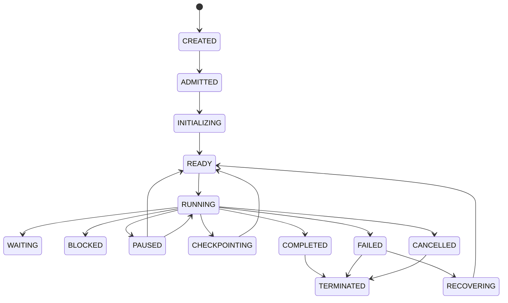
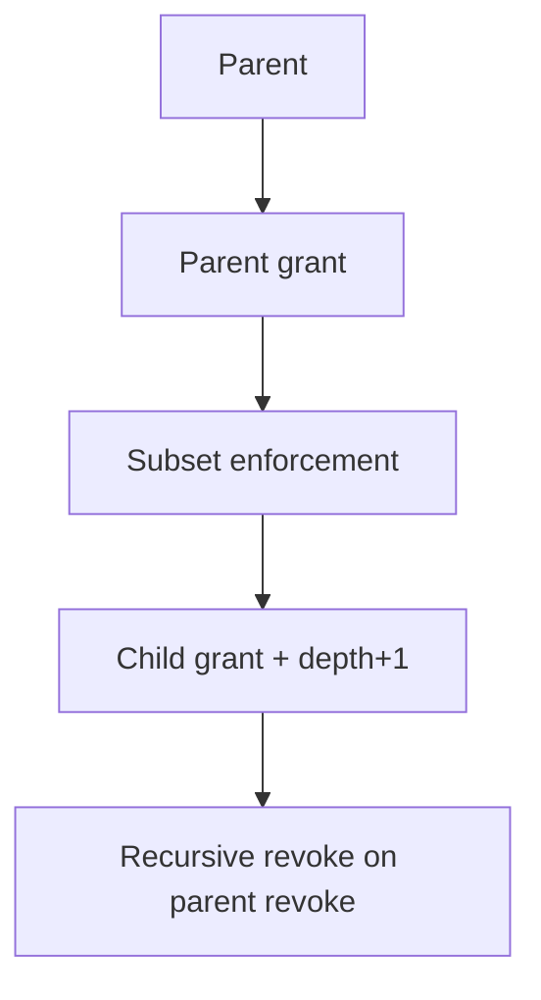

# AetherOS Agent Process

Source of truth: `kernel/core/types.py` — `AgentProcess`,
`AgentLifecycleState`; runtime: `kernel/core/agent_process_manager.py`.

## Identity

Every agent gets `AgentIdentity` (`agent_id`, key material, issuer,
trust level, tenant, scopes, status, expiry). Short-lived, revocable,
delegatable. Service accounts are scoped identities for automations —
never blind reuse of user credentials.

## Lifecycle



```text
CREATED → ADMITTED → INITIALIZING → READY → RUNNING → (WAITING | BLOCKED |
PAUSED | CHECKPOINTING | RECOVERING) → COMPLETED | FAILED | CANCELLED →
TERMINATED
```

Every transition is validated (`AgentProcess.transition()`) and emitted
on the event bus — no hidden lifecycle.

## Isolation (§5)

Isolated context, memory scope (`agent:<id>`), credentials (subset of
parent grant only), filesystem/network/tool/capability scopes, artifacts,
secrets, event subscriptions. Children never inherit authority implicitly:
`AuthorityManager.delegate_authority()` enforces
`ChildAuthority ⊆ ParentAuthority` plus delegation-depth limits, and
`PolicyEngine` re-checks (`child_authority_subset`, `delegation_depth`).

## Delegation


